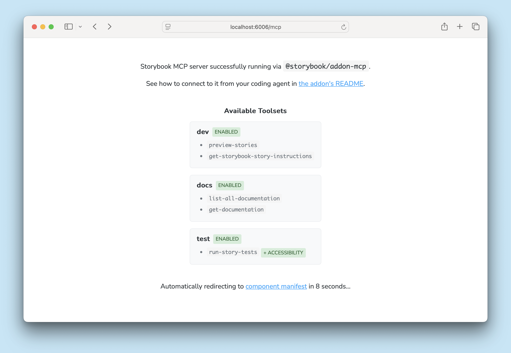

<If notRenderer={['react', 'vue', 'angular', 'svelte', 'web-components']}>

The Storybook MCP server lets your agent look up your components, write and test stories, and create a review of its work. It isn't available for your framework yet. See [supported frameworks](../connect.mdx#supported-frameworks).

</If>

<If renderer={['react', 'vue', 'angular', 'svelte', 'web-components']}>

The Storybook MCP server gives your agent the same capabilities as the [skills](../connect.mdx#install-the-skills) through the [Model Context Protocol](https://modelcontextprotocol.io/). Use it when you want your agent to call Storybook through MCP tools instead of CLI commands. Your agent still needs to run shell commands: the server tells it to read each step of the workflow with `npx storybook skills <id> --mcp`. For most setups, we recommend skills.

The MCP server runs as part of the Storybook dev server, so Storybook must be running for your agent to use it.

## Set up the MCP server

### 1. Install the addon

Run this command to install and register the Storybook MCP addon:

<CodeSnippets path="addon-mcp-add.md" />

When the dev server is running, the MCP server is available at `http://localhost:6006/mcp` (your port may be different). Open that URL in a browser to see the available tools and a link to the [manifest debugger](./manifests.mdx#debugging).

### 2. Check the components manifest

The MCP server's docs tools read the [components manifest](./manifests.mdx). Most frameworks that generate one turn it on by default. Check [framework support](./manifests.mdx#framework-support) to see whether you need to enable it. Without a components manifest, the docs tools are unavailable, but the other tools still work.

### 3. Add the MCP server to your agent

Run this command to add the MCP server to your agent:

<CodeSnippets path="mcp-add.md" />

Update the port in the URL if yours is different. When prompted, give the server a unique, descriptive name, such as `my-project-storybook`. Your agent uses this name to call the tools.

[`mcp-add`](https://github.com/paoloricciuti/mcp-add) adds MCP servers to many agents. You can also follow your agent's documentation to add the server manually, for example for [Claude Code](https://code.claude.com/docs/en/mcp#option-1-add-a-remote-http-server), [Gemini CLI](https://geminicli.com/docs/tools/mcp-server/#adding-an-http-server), [Codex](https://developers.openai.com/codex/mcp/), or [VS Code Copilot](https://code.visualstudio.com/docs/copilot/customization/mcp-servers#_configure-the-mcpjson-file).

[Host validation](../../api/main-config/main-config-core.mdx#allowedhosts) applies to the MCP server. If your agent reaches Storybook through a hostname other than `localhost`, such as a reverse proxy, add that hostname to `core.allowedHosts`.

### 4. Check the connection

The MCP server tells your agent when to use its tools, so you don't need to add instructions to `AGENTS.md`.

To check the connection, start Storybook, then ask your agent to "List all documented components". The agent should call the `docs-list` tool and list the components in your Storybook.

## Tools

The MCP server gives your agent the tools that your project supports. The page at `http://localhost:6006/mcp` shows which ones those are.

| Tool                                        | What it does                                                                                                                                      | Requires                                                                    |
| ------------------------------------------- | ------------------------------------------------------------------------------------------------------------------------------------------------- | --------------------------------------------------------------------------- |
| `stories-preview`                           | Gives direct links to stories                                                                                                                     |                                                                             |
| `stories-changed`                           | Lists the stories that your uncommitted changes affect                                                                                            | A builder that supports the module graph, such as Vite                      |
| `stories-find-by-component`                 | Finds the stories that use a component                                                                                                            | A builder that supports the module graph, such as Vite                      |
| `review-create`                             | Publishes an [agentic review](../skills/ui-review.mdx)                                                                                            |                                                                             |
| `docs-list`, `docs-show`, `docs-show-story` | Look up components and their documentation, including those of [composed Storybooks](../../sharing/storybook-composition.mdx) that have manifests | A [components manifest](./manifests.mdx)                                    |
| `test-run`                                  | Runs [story tests](../../writing-tests/index.mdx), with [accessibility checks](../../writing-tests/accessibility-testing.mdx) if they're set up   | The [Vitest addon](../../writing-tests/integrations/vitest-addon/index.mdx) |

</If>
{/* End supported renderers */}

**More AI resources**

- [Connect your agent](../connect.mdx)
- [Use a published Storybook](../published-storybook.mdx)
- [Manifests](./manifests.mdx)
