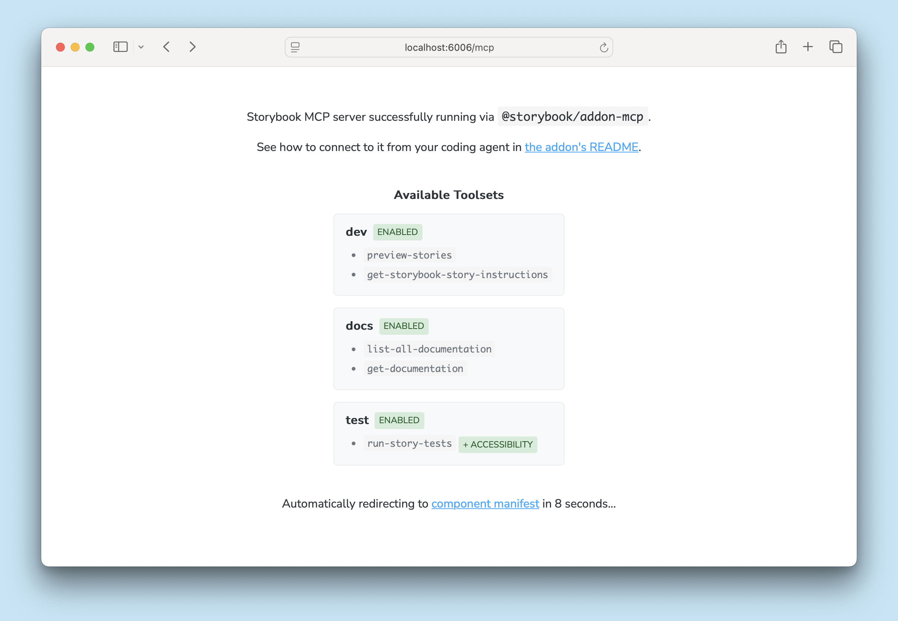

<If notRenderer={['react', 'vue', 'angular', 'svelte', 'web-components']}>

The Storybook MCP server lets your agent look up your components, write and test stories, and publish a review of its work. It isn't available for your framework yet. See [supported frameworks](../connect.mdx#supported-frameworks).

</If>

<If renderer={['react', 'vue', 'angular', 'svelte', 'web-components']}>

The Storybook MCP server gives your agent the same capabilities as the [skills](../connect.mdx#skills) through the [Model Context Protocol](https://modelcontextprotocol.io/). Use it when your agent can't run shell commands. For other agents, we recommend skills.

The MCP server runs as part of the Storybook dev server, so Storybook must be running for your agent to use it.

## Set up the MCP server

### 1. Install the addon

Run this command to install and register the Storybook MCP addon:

<CodeSnippets path="addon-mcp-add.md" />

When the dev server is running, the MCP server is available at `http://localhost:6006/mcp` (your port may be different). Open that URL in a browser to see the available tools and a link to the [manifest debugger](./manifests.mdx#debugging).



### 2. Check the components manifest

The MCP server's docs tools read the [components manifest](./manifests.mdx). Most frameworks that generate one turn it on by default. Check [framework support](./manifests.mdx#framework-support) to see whether you need to enable it. Without a components manifest, the docs tools are unavailable, but the other tools still work.

### 3. Add the MCP server to your agent

Run this command to add the MCP server to your agent:

<CodeSnippets path="mcp-add.md" />

Update the port in the URL if yours is different. When prompted, give the server a unique, descriptive name, such as `my-project-storybook`. Your agent uses this name to call the tools.

[`mcp-add`](https://github.com/paoloricciuti/mcp-add) adds MCP servers to many agents. You can also follow your agent's documentation to add the server manually, for example for [Claude Code](https://code.claude.com/docs/en/mcp#option-1-add-a-remote-http-server), [Gemini CLI](https://geminicli.com/docs/tools/mcp-server/#adding-an-http-server), [Codex](https://developers.openai.com/codex/mcp/), or [VS Code Copilot](https://code.visualstudio.com/docs/copilot/customization/mcp-servers#_configure-the-mcpjson-file).

[Host validation](../../api/main-config/main-config-core.mdx#allowedhosts) applies to the MCP server. If your agent reaches Storybook through a hostname other than `localhost`, such as a reverse proxy, add that hostname to `core.allowedHosts`.

### 4. Tell your agent when to use the MCP server

Add instructions to your project's `AGENTS.md` that tell your agent when to use the MCP server. Replace `my-project-storybook` with the name you chose in the previous step.

{/* TODO: Replace with the recommended MCP instructions for AGENTS.md once they are final. */}

```md title="AGENTS.md"
<!-- Placeholder: recommended instructions for the Storybook MCP server -->
```

To check the connection, start Storybook, then ask your agent to "List all documented components". The agent should call the `docs-list` tool and list the components in your Storybook.

## API

Pass these options when you register `@storybook/addon-mcp` in your `main.js|ts` file:

<CodeSnippets path="addon-mcp-options.md" />

### `toolsets`

Type:

```ts
{
  dev?: boolean;
  docs?: boolean;
  test?: boolean;
}
```

Default:

```ts
{
  dev: true,
  docs: true,
  test: true,
}
```

Turns each toolset of the MCP server on or off. All toolsets are on by default.

#### `dev`

Type: `boolean`

Default: `true`

Turns on the development tools, which write stories, find the stories that a change affects, preview them, and publish an [agentic review](../agentic-review.mdx). Finding affected stories requires a builder that supports the module graph, such as Vite.

#### `docs`

Type: `boolean`

Default: `true`

Turns on the docs tools, which look up components and their documentation. They're available only when your framework generates a [components manifest](./manifests.mdx) and the `componentsManifest` feature is on. If your Storybook [composes](../../sharing/storybook-composition.mdx) other Storybooks that have manifests, these tools include their components too.

#### `test`

Type: `boolean`

Default: `true`

Turns on the testing tool, which runs [story tests](../../writing-tests/index.mdx), with [accessibility checks](../../writing-tests/accessibility-testing.mdx) if they're set up. It's available only when `@storybook/addon-vitest` is installed and enabled.

</If>
{/* End supported renderers */}

**More AI resources**

- [Connect your agent](../connect.mdx)
- [Use a published Storybook](../published-storybook.mdx)
- [Manifests](./manifests.mdx)
