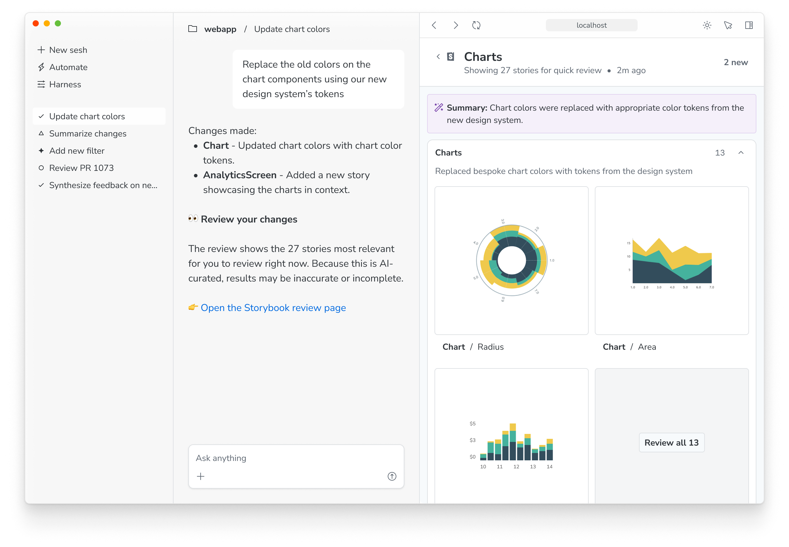
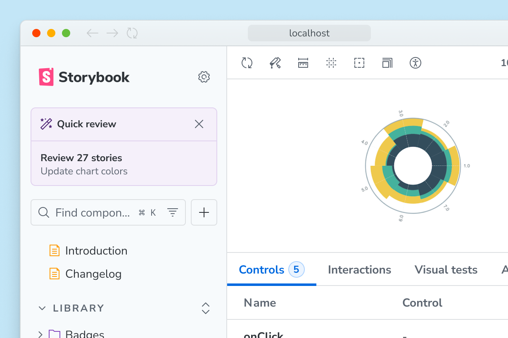
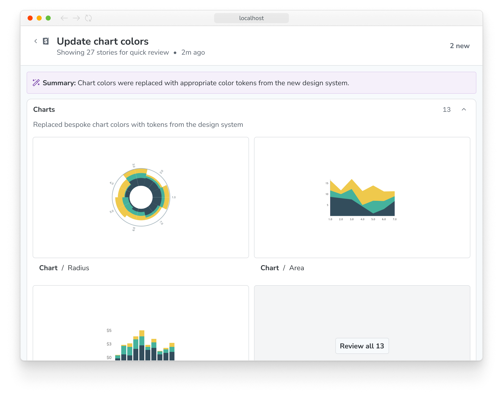
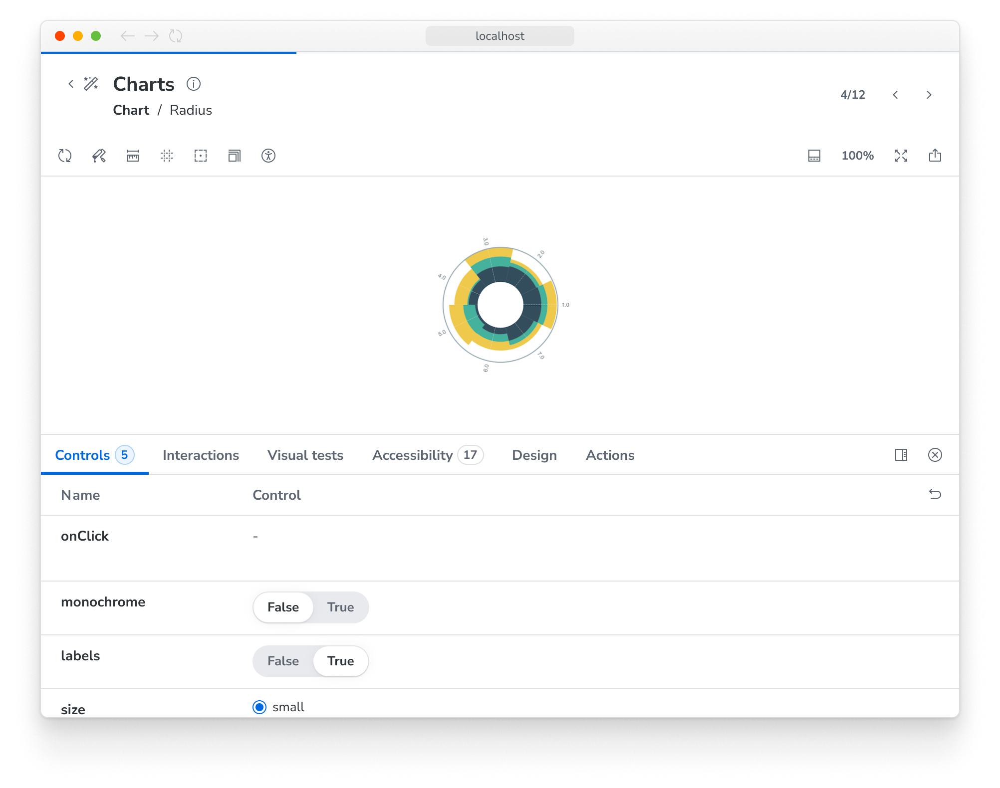
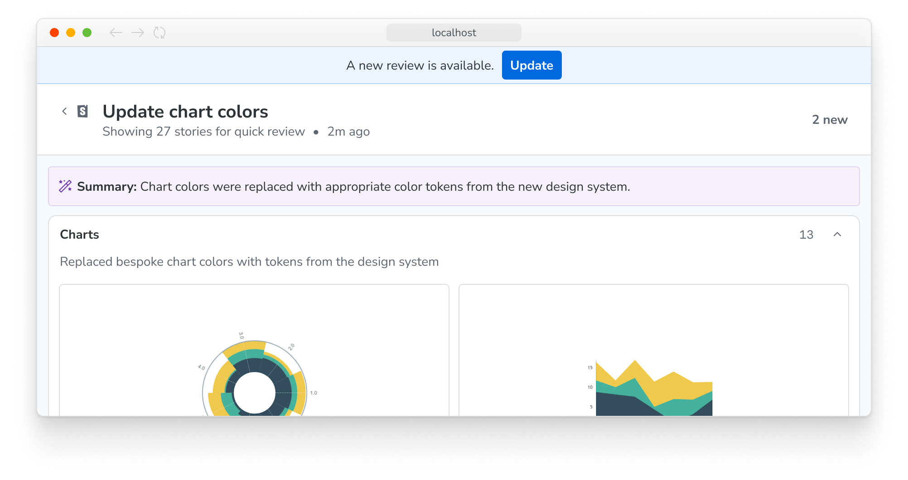

<If notRenderer={['react', 'vue', 'angular', 'svelte', 'web-components']}>

An agentic review shows you the UI your agent changed, in one place: a summary of its work and the stories that the change affects. It isn't available for your framework yet. See [supported frameworks](../connect.mdx#supported-frameworks).

</If>

<If renderer={['react', 'vue', 'angular', 'svelte', 'web-components']}>

An agentic review shows you the UI your agent changed, in one place. After a UI change, your agent publishes a review: a summary of its work and the stories that the change affects, grouped from the changed component up to the pages that use it.

## Requirements

- Storybook 11
- An agent connected with [skills](../connect.mdx#install-the-skills) or the [MCP server](../reference/mcp-server.mdx)
- A running Storybook dev server. With skills, your agent starts it if it isn't running.

## How your agent builds a review

The review is the last step of the [UI workflow](./ui-workflow.mdx). Your agent finds the stories that its change affects, then puts them into two to five groups, from the changed component up to the pages that show it. For example, a change to `Button` can give one group for the button's own stories, one for the forms that use it, and one for the pages around them. Every story the agent created is in the review.

A review is a curated selection, not a complete list of affected stories. The agent writes the summary and chooses the groups, so check them as you would check any other work by your agent.

The agent publishes a new review after each later change. You can also ask for one at any time, or ask to see components, for example "Show me the Button in all its states".

## Review the changes

To open a review, click the link at the end of your agent's reply, or click the review widget in the Storybook sidebar.

When a review is available, the widget takes the place of [change detection](../../configure/user-interface/change-detection.mdx) in the sidebar. You can still use the change detection filters to see new and modified stories.

The summary page shows the agent's description of the change and each group of stories, with a title and the reason the group is relevant.

To see a story in more detail, click its thumbnail. You can inspect the component with Storybook's features and your browser's tools, and [run tests](../../writing-tests/integrations/vitest-addon/index.mdx) if your Storybook is configured for them.

Use the next and previous buttons in the top-right corner to move through the stories in the review. Click **Back to review** to return to the summary page.

If files change after the agent publishes a review, a banner tells you that the review may be out of date. Copy the prompt in the banner to ask your agent for a new review.

When you're done, click the Storybook logo in the top-left corner to return to your Storybook.

</If>
{/* End supported renderers */}

**More AI resources**

- [Connect your agent](../connect.mdx)
- [UI workflow](./ui-workflow.mdx)
- [Best practices for using Storybook with AI](../best-practices.mdx)
