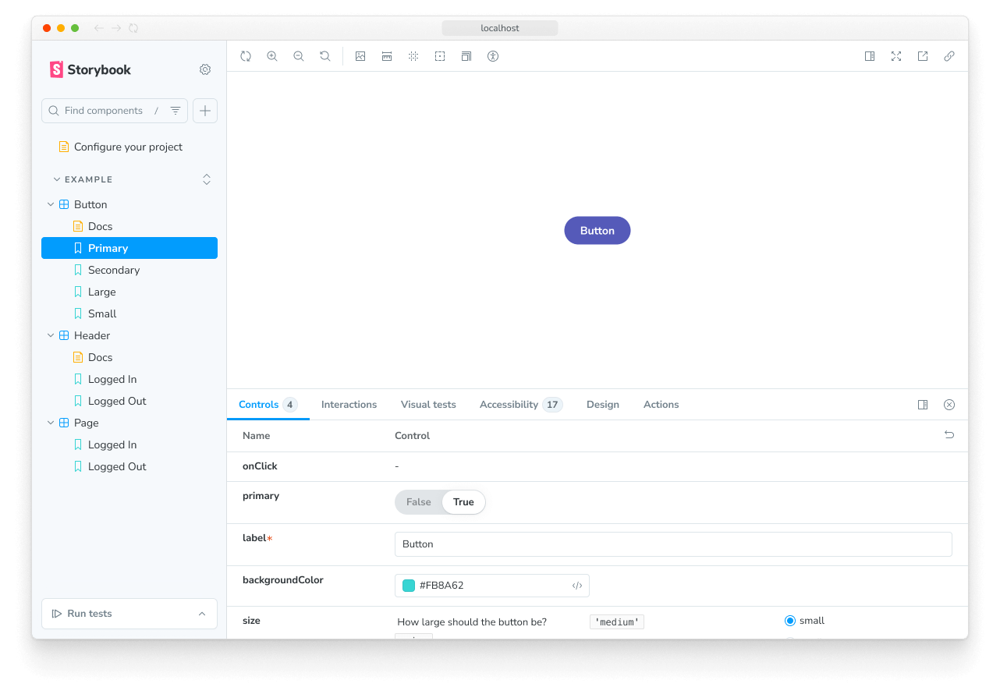

The `layout` [parameter](../writing-stories/parameters.mdx) allows you to configure how stories are positioned in Storybook's Canvas tab.

## Global layout

You can add the parameter to your [`./storybook/preview.js`](./index.mdx#configure-story-rendering), like so:

<CodeSnippets path="storybook-preview-layout-param.md" />

In the example above, Storybook will center all stories in the UI. `layout` accepts these options:

- `centered`: center the component horizontally and vertically in the Canvas
- `fullscreen`: allow the component to expand to the full width and height of the Canvas
- `padded`: _(default)_ Add extra padding around the component
- `none`: add no styles
- `document`: the story renders the whole document (see [below](#a-story-that-renders-the-whole-document))

## Component layout

You can also set it at a component level like so:

<CodeSnippets path="storybook-component-layout-param.md" />

## Story layout

Or even apply it to specific stories like so:

<CodeSnippets path="storybook-story-layout-param.md" />

## A story that renders the whole document

Some stories render a whole page, `<html>` and `<body>` included, rather than a component inside Storybook's page. Give them `layout: 'document'`:

- Storybook adds no layout and nothing to `<html>` or `<body>` but the id below: no classes, no `lang`, and no `#storybook-root` element of its own.
- The story's root is the `<body>` its render leaves. After every render Storybook gives that `<body>` the id `storybook-root`, which is what tools such as visual tests and the test runner look for, and passes it to `play` as `canvasElement`.
- A `<body>` that has an id of its own keeps it. That story has no `#storybook-root`, and Storybook logs a warning.
- CSS that targets `#storybook-root` (in `preview-head.html`, say) applies to that `<body>`.
- In a docs page the story renders in its own iframe, never inline, with a default height of 667px. Set [`parameters.docs.story.height`](../api/doc-blocks/doc-block-story.mdx#height) to change it.

A `play` function that navigates to a page that loads a new document gets a new `<body>`, which has no `#storybook-root` until the story renders again. Query the new page with `within(document.body)`.
