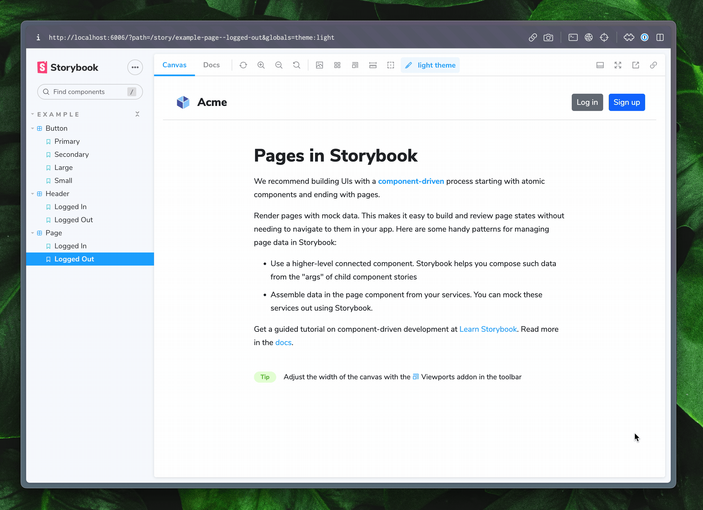

Storybook's [Themes](https://github.com/storybookjs/storybook/tree/next/code/addons/themes) addon allows you to switch between multiple themes for your components inside of the preview in [Storybook](https://storybook.js.org).

## Theme decorators

`@storybook/addon-themes` exposes [decorators](https://storybook.js.org/docs/writing-stories/decorators) for CSS classes and data attributes. React providers use `withThemeFromJSXProvider` from `@storybook/addon-themes-react`.

### JSX providers

For libraries that expose themes to components through providers, such as [Material UI](https://storybook.js.org/recipes/@mui/material/), [Styled-components](https://storybook.js.org/recipes/styled-components/), and [Emotion](https://storybook.js.org/recipes/@emotion/styled/), install `@storybook/addon-themes-react` and use `withThemeFromJSXProvider`. Register `@storybook/addon-themes` in `main.ts`. Do not register the React package.

<CodeSnippets path="storybook-addon-themes-jsx-provider-decorator.md" />

### CSS classes

For libraries that rely on CSS classes on a parent element to determine the theme, you can use the `withThemeByClassName` decorator.

<CodeSnippets path="storybook-addon-themes-classname-decorator.md" />

### Data attributes

For libraries that rely on data attributes on a parent element to determine the theme, you can use the `withThemeByDataAttribute` decorator.

<CodeSnippets path="storybook-addon-themes-data-attribute-decorator.md" />
